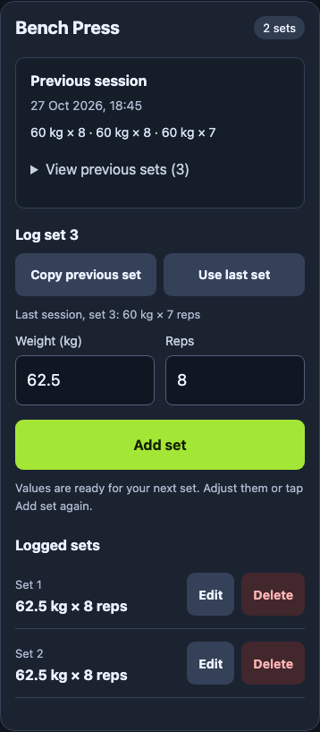
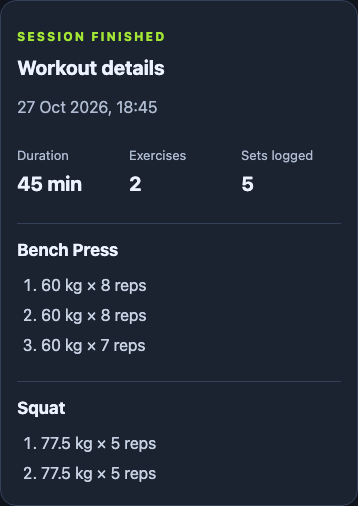

# Strength Training

A mobile-friendly workout logger built with React, TypeScript, Express, and PostgreSQL. Log sets immediately on your device, reopen the cached app offline, and sync saved changes when connectivity returns.

**[Open the live app](https://strength-training-app-six.vercel.app)**

The core app is deployed. Automated browser and database checks pass; the final real workout on the hosted app (Day 26) and demo recording (Day 28) remain open.

## What you can do

- Start or resume a workout and choose from eight exercises.
- Add, edit, delete, and copy sets with weight in kilograms and repetitions.
- See the previous completed session beside the exercise you are logging.
- Finish a session, browse history, and inspect its exercises and sets.
- Keep logged sets after refresh or offline reopening.
- Create an email/password account and explicitly enable device sync.
- Retry interrupted uploads without duplicate sets; preserve edits and deletions while offline.

Typed inputs become persistent when you save the set. Wait for **Saved on this device** before closing the app. **Synced to …** additionally confirms server uploads and a completed download/merge.

## Screenshots

| Active workout and previous sets | Completed workout details |
| --- | --- |
|  |  |

[Home](docs/screenshots/home.png) · [History](docs/screenshots/history.png)

Screenshots use synthetic workout data in an isolated browser. They show the actual production build; no personal account or workout data is included. [Capture notes](docs/screenshots/README.md)

## Use it on your iPhone

1. Open the live app in Safari while connected.
2. Open **Account**, create an account or sign in, then choose **Enable sync for this device**.
3. Wait for **Ready for offline use**, then use Safari's **Add to Home Screen** action.
4. Log and finish workouts offline. Reopen the app with connectivity to sync, or choose **Sync now**.

An account is optional for local logging. The hosted app does not need your Mac running. Keep the same address: browser storage at an old Mac address does not automatically transfer to the hosted address. See [data and account limits](docs/limitations.md).

## Run locally

Prerequisites: **Node.js 22.x**, npm, and **PostgreSQL 17**. There are separate package manifests in `frontend/` and `backend/`; run npm commands in the relevant folder.

```sh
git clone https://github.com/Blazene/strength-training-app.git
cd strength-training-app
npm --prefix backend ci
npm --prefix frontend ci
```

Follow [local setup](docs/setup.md) to create a development database, configure the ignored `backend/.env`, and run migrations. Then keep two terminals open:

```sh
# Terminal 1 — API, port 4001
cd backend
npm run dev
```

```sh
# Terminal 2 — from the repository root, frontend, port 5173
cd frontend
npm run dev
```

Open <http://localhost:5173/>. The frontend proxies `/api` to the local backend. Development hot reload does not install the offline worker; use the production-preview instructions in [setup](docs/setup.md#test-offline-reopening-locally) to test app caching.

## How it works

React holds the screen state and unfinished form inputs. Each saved workout change and its pending sync operation commit together in IndexedDB. The sync controller sends complete workout snapshots with stable operation IDs; the API validates the session and payload, then commits the workout and receipt together in PostgreSQL. Repeating an acknowledged request replays its receipt.

A service worker caches the app files separately from workout data. It excludes account/API responses and keeps the previous usable shell if an update cannot download completely. [Architecture and sync flow](docs/architecture.md)

```text
frontend/  React screens, IndexedDB, sync controller, PWA build plugin
backend/   Express API, Better Auth sessions, SQL migrations and validation
docs/      Setup, architecture, limitations, screenshots and milestone notes
vercel.json  Same-origin routing for the frontend and API services
```

## Verification

The complete regression suite builds both apps, runs frontend tests/lint and backend database tests, then exercises Chromium and WebKit with disposable profiles and an isolated PostgreSQL cluster:

```sh
cd frontend
npm run test:e2e:install
npm run test:e2e
```

Run `npm ci` in both packages first. PostgreSQL server tools must be available; the suite discovers `pg_config` or the standard Homebrew PostgreSQL 17 installation. It does not read the app's database credentials or use its database. [Test setup and scenarios](docs/day-22.md)

The deployed milestone passed **24 frontend tests, 20 backend tests**, both builds, lint, hosted Chromium/WebKit flows, and a public WebKit offline-restart/sync check. [Production results](docs/day-25.md)

## Project notes

| Topic | Guide |
| --- | --- |
| Local install, environment, ports, troubleshooting | [Setup](docs/setup.md) |
| Persistence, sync, authentication, API and file map | [Architecture](docs/architecture.md) |
| Entities, keys, versions and deletion markers | [Data model](docs/data-model.md) |
| Browser storage, accounts, devices and unfinished work | [Known limitations](docs/limitations.md) |
| Hosting and manual releases | [Deployment](docs/day-24.md) |
| Original plan and current progress | [Roadmap](docs/roadmap.md) |

This version assumes one person logs from one device at a time. Email verification/password reset, simultaneous editing, automatic backups, AI recommendations, social features, nutrition and wearable integrations are outside its current scope. GitHub pushes do not automatically redeploy the hosted app; releases are currently manual.
