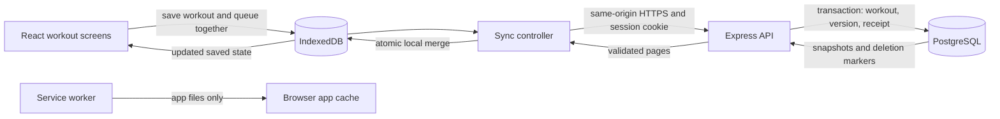

# Architecture

The app serves a phone workout flow: open or resume a session, log sets locally, finish it, and upload saved changes when the app is open with connectivity. The browser does not wait for a server round trip before confirming a local save.

## Components and boundaries

| Technology | Responsibility |
| --- | --- |
| React + TypeScript | Workout screens, form drafts, history and visible save/sync state |
| IndexedDB | Durable workout state, account-bound metadata and pending operations |
| Service worker + Cache API | HTML, JavaScript, styles and install assets for offline reopening |
| Node + Express | Authentication boundary, input validation, owned workout endpoints and synchronization |
| Better Auth | Email/password hashes, server sessions and account rate limiting |
| PostgreSQL | Accounts, ordered workout records, versions, receipts and deletion markers |
| Vercel Services + Neon | One public HTTPS origin for frontend/API, with hosted PostgreSQL |

## A local save

Form fields are React state until Add/Save is pressed. `useWorkouts` passes a revisioned update to `saveWorkouts`. One IndexedDB transaction commits the next workout state and its pending sync intent. React receives the saved state only after success. A failed transaction retains the previous saved state and reports the error; a failed set save keeps its inputs available for retry.

The `strength-training` IndexedDB database is version 2. Its `workouts` store contains:

| Key | Contents |
| --- | --- |
| `state` | Revision, active workout, completed history and any other unfinished sessions |
| `sync:metadata` | Device ID, linked owner, next sequence, baselines, server versions, conflicts and sync times |
| `sync:pending:<UUID>` | Immutable operation identity, workout snapshot/delete intent and persistent retry state |

A workout snapshot contains ordered exercises and sets; stable client-generated UUIDs identify records. Local revision checks and storage signals keep tabs from silently replacing a newer saved state. Unfinished form inputs are deliberately separate and are not restored after closing.

## Uploads and retries

1. Signing in identifies an account. The separate **Enable sync for this device** action binds existing local workouts and pending work to that account.
2. The controller checks the current server session against the linked owner, downloads server changes, and selects the newest pending intent for each workout.
3. `POST /api/sync` sends the stable operation UUID, expected account, device UUID, monotonic sequence, workout UUID, full snapshot or deletion, and an optional base version. New writes require `X-Strength-Sync-Protocol: 2`.
4. The API derives the actual owner from the session, validates the request, serializes that account's writes, and commits the workout, version/state, and receipt in one SQL transaction.
5. The client validates the returned owner, operation ID, outcome and version. It can then acknowledge that operation and covered older snapshots. A newer concurrent save remains queued.

If the response is lost after a commit, retrying the same ID/payload replays the original receipt. Reusing an ID for a different payload conflicts. Sequence guards prevent older writes from replacing newer state. Deletion markers survive removal of workout rows so a delayed upload does not recreate a deleted session.

Network failures retain pending work and use persistent backoff with jitter. Invalid data or version conflicts need attention instead of an endless automatic retry. A session expiry or different signed-in account pauses uploads without changing queue ownership. Sync runs on opening, returning, reconnecting, saves and manual retry; it does not rely on the app running after it closes.

## Downloads and device handoff

`GET /api/sync/workouts` pages by workout UUID and includes snapshots, versions and tombstones. Each SQL page uses a consistent database snapshot. The client validates the complete set of pages before one IndexedDB merge; it does not partially import a failed download or treat a missing ID as deletion.

Pending local changes remain protected. Server replacements wait while a workout has unfinished form input. Clean imported snapshots become the baseline without being uploaded again. Additional active workouts are kept as resumable unfinished sessions. A fresh base version permits a logging-device handoff; stale writes produce a conflict. **Keep both versions** preserves a distinct local copy and applies the server version atomically.

This supports sequential use from different devices. It is not a simultaneous-editing protocol. See [limitations](limitations.md).

## Offline app files

IndexedDB stores workouts; it cannot make an uncached web page open offline. The production build separately emits `sw.js` and `app-shell.json`. Installation caches the shell; the UI checks the active worker's required files before reporting **Ready for offline use**.

Navigation tries the network with a short timeout when a fallback exists. A changed build downloads its asset batch before replacing cached HTML. Failed or interrupted updates retain the previous usable shell. Worker updates wait for existing app tabs to close, protecting unfinished input from forced reloads. API requests and non-GET traffic bypass app-file caching.

The worker is disabled for Vite development hot reload. Test caching against a production preview or the hosted HTTPS app.

## Accounts and security

The browser sends first-party session cookies with relative `/api` requests. Better Auth stores account/password hashes and sessions in PostgreSQL; tokens are not stored in IndexedDB or localStorage. HTTPS sessions use Secure, HttpOnly, SameSite=Lax cookies scoped to `/api`. Host/origin checks run before account and API handlers. Read queries and mutations use the verified owner, with composite account/workout keys and account-aligned child foreign keys.

Production requires explicit HTTPS origins, a separate secret, and a hosted database URL with verified TLS. Login limits use PostgreSQL across function instances; local development uses in-memory limits. Only the Vercel runtime trusts the platform's overwritten client-IP header. Browser bundles receive no database credentials. API responses use `Cache-Control: no-store`.

## API surface

| Route | Purpose |
| --- | --- |
| `GET /api/health`, `GET /api/health/db` | API and database availability |
| `/api/auth/*` | Better Auth account/session routes |
| `GET /api/me`, `GET /api/exercises` | Current account and canonical exercise library |
| `GET /api/workouts`, `GET /api/workouts/:id` | Owned summaries and full ordered records |
| `PUT /api/workouts/:id`, `DELETE /api/workouts/:id` | Validated direct CRUD; cannot bypass established sync ownership/version/deletion rules |
| `POST /api/sync` | Retry-safe snapshot or deletion operation |
| `GET /api/sync/workouts` | Account-checked paginated snapshots and tombstones |

Workout/sync routes require a valid session. Payloads are limited to 256 KiB, 30 exercises and 100 sets per exercise. Validation rejects unknown ownership fields, invalid UUIDs/dates, duplicate items, impossible completion times, negative/nonfinite weights and nonpositive/noninteger reps. Exercise names come from the canonical library. Conflict and validation failures leave stored data intact.

## Where to read the implementation

| Boundary | Files |
| --- | --- |
| Screens and local commit flow | `frontend/src/App.tsx`, `hooks/useWorkouts.ts`, `components/ExerciseCard.tsx` |
| Local transactions and merge | `frontend/src/storage/workouts.ts`, `storage/sync.ts`, `sync/merge.ts` |
| Retry/session lifecycle | `frontend/src/sync/controller.ts`, `sync/network.ts`, `hooks/useWorkoutSync.ts` |
| App-file caching | `frontend/pwa/offlinePlugin.ts`, `src/utils/offlineCache.ts` |
| Auth and API | `backend/src/app.ts`, `auth.ts`, `config.ts` |
| Owned SQL and migrations | `backend/src/workouts.ts`, `sync.ts`, `migrations.ts`, `backend/migrations/` |
| Cloud entry and routing | `backend/src/index.ts`, `database-config.ts`, `vercel.json` |

The [data model](data-model.md) expands table/key details. [Day 22](day-22.md) records failure-path coverage and [Day 25](day-25.md) records hosted verification.
